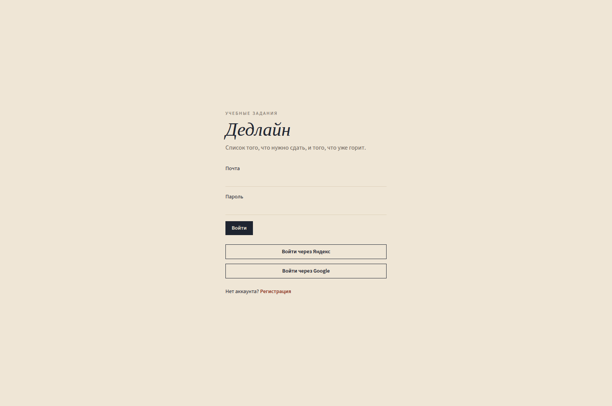
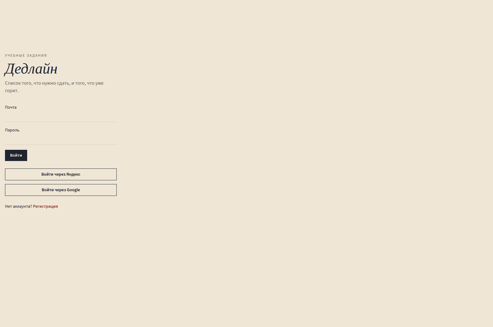

# Отчёт о разработке фронтенда

## Что собрано

Интерфейс «Дедлайна» по концепции «Чернильница» и техническому заданию из задания 3.

Три функции, которые видны без чтения кода:

1. Вход и регистрация, плюс кнопки Яндекс и Google.
2. Список заданий: создание, правка, удаление, шаг статуса на строке.
3. Сводка и фильтр. Счётчики считаются по всему списку, фильтр сужает только ленту. Просроченное поднимается наверх.

Стек: React 18, TypeScript, Vite, Tailwind 4, React Router 7, Vitest.

## Как применялся агент

Файл `deadline/.cursorrules` — копия правил из задания 2. По ним собраны именованные экспорты, русские подписи статусов и состояния загрузки, ошибки и пустого списка.

Промпты, которые реально уходили субагентам, и их сырые ответы разобраны в `../dz2/`. Для экрана важны два результата:

- Карточка с правилами получила `data-testid` и подпись «Готово». Боевой компонент `frontend/src/components/AssignmentCard.tsx` держит тот же контракт и палитру Чернильницы, которой в контрольном прогоне не было, потому что в правилах не заданы цвета.
- Цепочка из трёх промптов зафиксировала правило «сводка по полному списку». Его повторяют `frontend/src/domain.ts` и SQL в `backend/src/db.ts`.

Отдельный прогон [Функция просрочки](ad05d20a-c73b-46ce-9c05-789955d275d1) дал `isOverdue` и `formatDueLabel`. В интерфейсе та же логика: готовое задание с прошедшей датой не красное, битая дата не роняет строку.

## Итерации и поломки

- Первый набросок маршрутов клал вложенный `Routes` внутрь `path="/*"`. Список мог не совпасть с адресом. Маршруты переписаны на общий `RequireAuth` и `Outlet`.
- Tailwind 3 тянул уязвимый `braces` через файловый наблюдатель. Сборка переведена на Tailwind 4 и плагин `@tailwindcss/vite`. Классы в компонентах остались прежними, цвета переехали в `@theme` в `src/index.css`.
- `npm audit` на фронтенде сначала показал critical в Vitest и moderate в React Router. Стоят Vitest 5.0.3 и React Router 7.18.4. Повторный аудит: 0 vulnerabilities.
- Кнопка «Войти» неактивна, пока не ответил `GET /api/auth/me`. Это видно на снимке, если снимок снять в ту же секунду, что и загрузку. После ответа кнопкой можно пользоваться. Пустой список и ошибка сети на дашборде разведены: сеть показывает баннер и «Повторить», пустой список — текст «Пока пусто».

## Адаптив

Проверены две ширины экрана входа.

Десктоп, форма по центру бумажного фона:

Ширина 390px. Текст переносится, кнопки OAuth остаются в колонке, горизонтальной прокрутки нет:

Дашборд на узкой ширине устроен так же: шапка вместо боковой колонки (`md:hidden` / `hidden md:flex`), сводка `grid-cols-2`, строка задания складывается в одну колонку до `md`. Отдельный снимок ленты после входа в этом прогоне не снят: ввод почты в форму браузерный инструмент отклонил как внешнюю форму. Данные ленты проверены запросом к API (4 задания, 1 просроченное) и тестами карточки. Вёрстка строки — та же, что на макете `../dz3/ui_concepts/ink.png`.

## Тесты

Во фронтенде 8 тестов в трёх файлах, все проходят:

- правила просрочки, фильтра, сводки и пустого названия;
- состояния карточки и русская подпись «В работе»;
- аналитика молчит без номера счётчика и шлёт цель, когда счётчик и `ym` есть.

Команда: `npm test --prefix frontend`.

## Что сработало

Короткий файл правил и отдельный прогон «с правилами / без» дали конкретную разницу, а не общее ощущение «стало лучше». Цепочка из трёх промптов удержала сводку отдельно от фильтра. Для вёрстки полезнее оказался один выбранный макет, чем просьба «сделай красиво»: цвета и шрифты взяты из «Чернильницы», а не из фиолетового шаблона.
