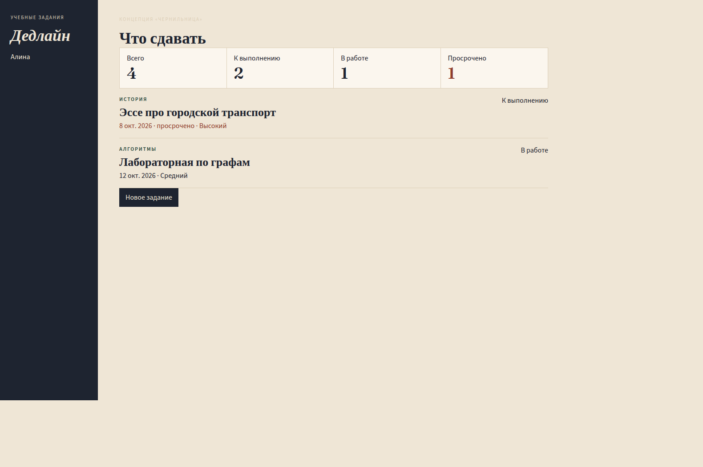
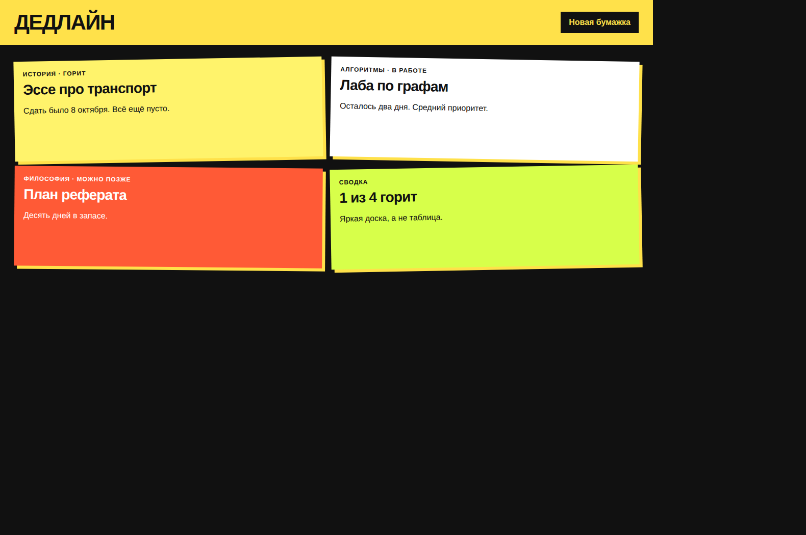
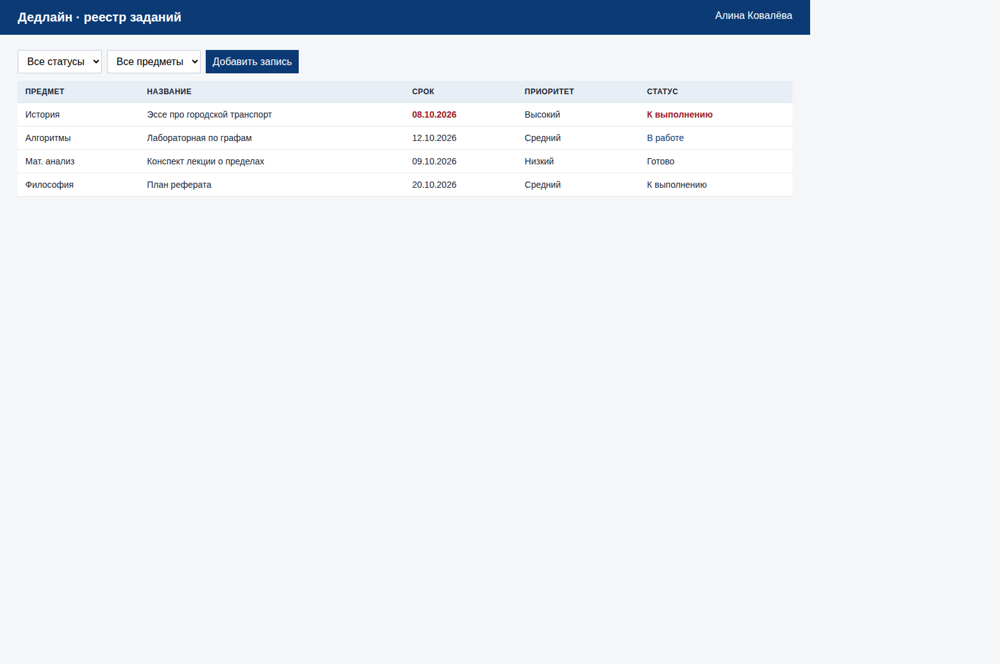

# Три концепции интерфейса

Макеты собраны как отдельные HTML-экраны и сняты в браузере. Исходники и снимки лежат в этой папке.

## Чернильница

Тёмный узкий бок, бумажный фон, заголовок антиквой, цифры сводки в линейке, задания строками, а не плитками. Просроченная дата — сургучный красный, предмет — зелёный капсом.

Плюсы: спокойно читается каждый день, статус подписан словами, а не только цветом, на телефоне бок превращается в тёмную шапку. Минусы: мало «вау» на первом показе, плотная строка прячет длинный комментарий.

## Маркер

Чёрный фон, жёлтая шапка, карточки как стикеры с поворотом и тенью. Сводка тоже стикер.

Плюсы: просрочка заметна сразу, настроение студенческое. Минусы: четыре стикера на телефоне разъезжаются, поворот мешает сканировать список из двадцати работ, цвет несёт слишком много смысла.

## Деканат

Синяя шапка, серый фон, плотная таблица: предмет, название, срок, приоритет, статус.

Плюсы: много строк на экране, привычно для журнала. Минусы: на ширине телефона таблица либо скроллится вбок, либо теряет столбцы. Для личного списка из нескольких работ таблица выглядит канцелярски.

## Выбор

Выбрана **Чернильница**.

Список Алины короткий, его читают вечером, а не сверяют как ведомость. Строка с предметом, названием и датой сканируется быстрее стикера и не ломается на узком экране так, как таблица из пяти колонок. Красный оставлен только для просрочки, статус всегда написан текстом. Приложение в `deadline/` собрано по этой концепции: те же фон, бок, линейка счётчиков и строка задания. Экран входа снят отдельно в `deadline/docs/screenshots/`.
